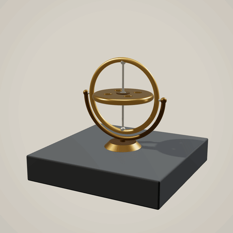
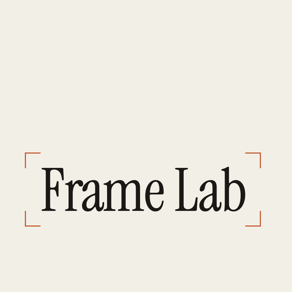
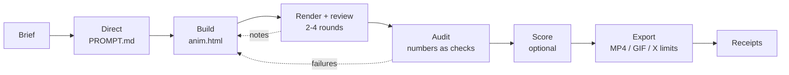
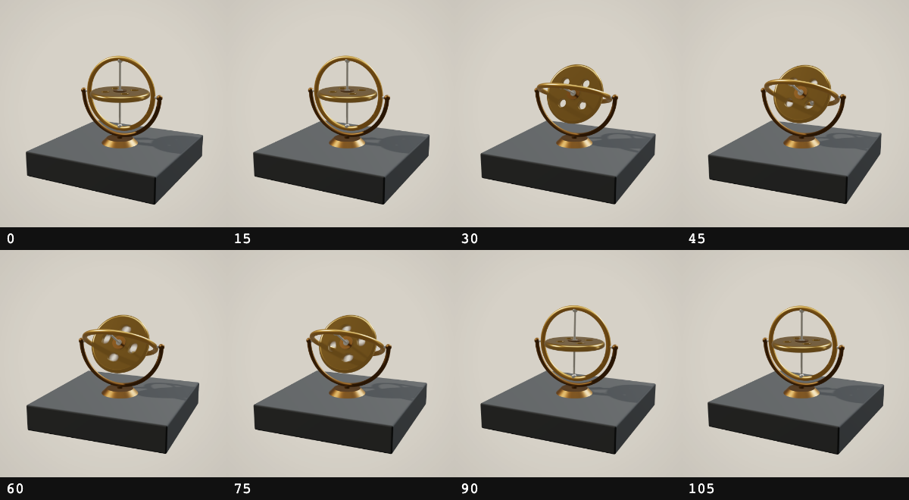

# motion-lab

**A Claude Code plugin for directed, frame-exact motion design.**

Claude writes code that draws every frame of an animation, then renders it, looks at the frames, measures them,
fixes what's off and exports it for X and the web. Because each frame is a pure function of time, every frame is
reproducible, every edit is a number, and Claude can check its own work instead of saying "looks great".

<p align="center">
  
  &nbsp;
  
</p>
<p align="center"><sub>Both loops were made by the plugin from a two-sentence brief, in one headless session each
(three.js, 44 turns; plain HTML, 38 turns).</sub></p>

## Contents
- [Quick start](#quick-start)
- [How it works](#how-it-works)
- [The render contract](#the-render-contract)
- [What's inside](#whats-inside)
- [Project configuration](#project-configuration)
- [Status and limitations](#status-and-limitations)
- [Development](#development)
- [Credits](#credits)

## Quick start

**1. Install the plugin**
```bash
claude plugin marketplace add ajitpratap0/motion-lab
claude plugin install motion-lab@motion-lab
```
Or inside a Claude Code session: `/plugin marketplace add ajitpratap0/motion-lab`, then
`/plugin install motion-lab@motion-lab`.

**2. Have the tools on your machine**

| Tool | Why | Install |
|---|---|---|
| Node.js 20+ | runs the scripts | `brew install node` / `winget install OpenJS.NodeJS.LTS` |
| ffmpeg + ffprobe | encoding, GIFs, contact sheets, audio measurement | `brew install ffmpeg` / `winget install Gyan.FFmpeg` |
| Playwright + Chromium | renders frames | per project: `npm i -D playwright && npx playwright install chromium` |

`/motion-lab:motion-setup` checks all three and scaffolds the project folder. It never installs system packages
without asking.

**3. Ask for an animation** in an empty folder:
```text
/motion-lab:motion-lab Make a 5-second seamless three.js loop, 1080x1080 at 24 fps: a small brass gyroscope on a
slate plinth. The outer ring tips over, the inner rotor spins up, and the whole thing settles back to rest so the
loop closes. Studio product look, soft key light, one rim light, no text.
```

You end up with:

```
motion-lab.json   project settings (size, fps, length, ban list)
PROMPT.md         the directed prompt: every adjective replaced by a number
anim.html         the scene, one self-contained file
audit.json        machine checks derived from PROMPT.md
RECEIPTS.md       your brief, the directed prompt, every follow-up, audit and export results
out/anim.mp4      H.264, X-ready
out/anim.gif      single palette, exact frame delays
out/post.md       caption + reply thread showing how it was made
```

You can also call any step on its own, for example `/motion-lab:motion-review` on an existing scene or
`/motion-lab:motion-fix` when a render flickers.

## How it works



1. **Direct.** The brief becomes a prompt on a fixed template: GOAL, OUTPUT, TIME, LOOK, MOTION, SHOTS, BANNED, QA.
   "Smooth and premium" becomes `cubic-bezier(0.22, 1, 0.36, 1)` over 18 frames.
2. **Build.** One HTML file (plain DOM/Canvas/SVG, three.js, or a Remotion / HyperFrames / Motion project) that
   follows the render contract. A hook lints every edit.
3. **Render and review.** A review pack (stills, labelled contact sheet, speed graph, probe values) goes to the
   `motion-reviewer` agent, which returns notes tied to frame numbers. One or two notes are applied per round.
4. **Audit.** The `motion-auditor` agent turns every number in the prompt into a check (hit frames, landing values,
   bounds, loop seam, determinism) and runs them against the live scene.
5. **Score** (optional). Sound is synthesized in code from the scene's events with Web Audio, then measured from
   the decoded file: each hit lands one frame after its picture, about -14 LUFS, true peak at or below -1 dBTP.
6. **Export.** MP4 and GIF are checked against X's limits, and the loop seam is diffed.
7. **Receipts.** Your words and Claude's directed prompt are kept apart and counted, so the post says honestly
   how it was made.

<p align="center">
  
  <br><sub>Part of a review pack: a contact sheet with frame numbers, so review notes can name the frame.</sub>
</p>

## The render contract

Every scene obeys a short contract, enforced by `contract-lint` and the `PostToolUse` hook:

- Every frame is a pure function of time: `window.renderAt(t)` draws exactly that frame.
- No clocks, timers, CSS transitions or unseeded `Math.random` drive motion.
- With `?t=` in the URL the scene draws once and stops, so any frame renders on its own.
- `window.__ready` waits for fonts, textures and bakes; `window.__probe(t)` exposes the hero values;
  `window.__events` lists the hits sound should land on.
- Loops render frames `0..N-1`, and frame `N-1` flows into frame `0`.
- Libraries are pinned to an exact version.

Full text and reasons: [`plugin/reference/contract.md`](plugin/reference/contract.md).

## What's inside

### Skills
| Skill | What it does |
|---|---|
| `motion-lab` | Runs the whole pipeline and routes to the skills below |
| `motion-setup` | Checks node, ffmpeg and Playwright; creates `motion-lab.json`, `RECEIPTS.md`, `out/` |
| `motion-direct` | Turns a brief into a directed prompt in `PROMPT.md` |
| `motion-build` | Builds the scene under the render contract until it lints clean |
| `motion-render` | Frames, stills, contact sheets, onion skins, speed graphs, frame diffs, motion blur |
| `motion-review` | Review pack, frame-anchored notes, one or two fixes per round, all logged |
| `motion-audit` | Every number in the prompt becomes a check on the live scene |
| `motion-score` | Web Audio score from the scene's events, measured and iterated |
| `motion-export` | MP4, exact-delay GIF, loop check, X limits |
| `motion-fix` | Symptom to measured fix: flicker, seam hiccups, beat drift, banding, late hits |
| `motion-receipts` | `RECEIPTS.md` to a caption and reply thread |

### Agents
| Agent | Model | Role |
|---|---|---|
| `motion-reviewer` | Sonnet | Reads the review pack, returns frame-anchored notes |
| `motion-auditor` | Sonnet | Writes `audit.json` from the prompt's numbers |
| `motion-mixer` | Sonnet | Writes sound follow-ups from measurements |
| `motion-receipts` | Haiku | Formats receipts into a post |

The main session directs, builds, and decides which notes to apply.

### Hooks
- `UserPromptSubmit` appends your prompts to `RECEIPTS.md`, only inside folders that have a `motion-lab.json`.
  Set `"receipts": false` there to turn it off.
- `PostToolUse` lints edited `.html` scenes against the render contract and feeds errors back to Claude.

### Scripts
Zero runtime dependencies; Playwright is a peer dependency resolved from your project first.

`render` · `probe` · `audit` · `lab` (review pack) · `contact-sheet` · `onion-skin` · `speed-graph` ·
`diff-frames` · `contract-lint` · `inject` · `beats` · `score` · `audio-measure` ·
`export` (`mp4` | `gif` | `loopcheck` | `xcheck`)

Every script takes `--help` and `--json`. Exit codes: 1 error, 2 Playwright missing, 3 a check failed.
Reference: [`plugin/scripts/README.md`](plugin/scripts/README.md).

### References
Prompt template, motion numbers and tokens (`motion-tokens.js`: easings, analytic springs, seeded noise, beat
grid), ban list, principles, follow-up patterns, fixes, sound, X export limits, engine notes for
[HTML](plugin/reference/engines/html.md), [three.js](plugin/reference/engines/threejs.md),
[Remotion](plugin/reference/engines/remotion.md), [HyperFrames](plugin/reference/engines/hyperframes.md) and
[Motion](plugin/reference/engines/motion-react.md), and two worked examples. All in
[`plugin/reference/`](plugin/reference/).

The official Remotion, HyperFrames, GSAP and Motion plugins pair well with this one for engine-specific API help.

## Project configuration

`motion-lab.json` in the project folder sets the defaults every script uses; CLI flags override it.

```json
{
  "name": "brass-gyroscope",
  "engine": "threejs",
  "file": "anim.html",
  "width": 1080,
  "height": 1080,
  "fps": 24,
  "secs": 5,
  "loop": true,
  "bpm": 96,
  "banned": ["turntable spin", "bloom", "lens flares", "text"],
  "linear_ok": ["rotorDeg"],
  "receipts": true
}
```

`linear_ok` lists probe values that are meant to move linearly (a spinning rotor), so the speed check doesn't
flag them.

## Status and limitations

v0.1.0. Tested end to end on a plain-HTML kinetic-type loop and a three.js product loop: direct, build, review,
audit, export and receipts.

- Remotion (4.0.536), HyperFrames (0.8.217) and Motion (14.2.0) were each checked with a small scene: render,
  audit or value checks, export and xcheck, and for HyperFrames a frame match against its own renderer. They
  haven't had a full directed project run yet. Notes from these checks are in the engine docs.
- Sound was checked on the 2D loop: a Web Audio score with three hits, two mixer rounds, then muxed. Final MP4:
  hits 0 ms from frame+1 and 3.5 dB over the bed, -13.9 LUFS, -1.1 dBTP, no audio/video offset. Reports are welcome.
- Export targets X's limits. Other platforms work but aren't checked.
- Rendering is frame by frame in headless Chromium. It's exact, not fast: a 5-second 1080p three.js loop with
  12-sample motion blur takes a few minutes.

## Development

```bash
git clone https://github.com/ajitpratap0/motion-lab
cd motion-lab/plugin
npm i --no-save --no-package-lock playwright@1.58
npx playwright install chromium
npm test
```

Try a local checkout with `claude plugin marketplace add ./motion-lab` and
`claude plugin validate motion-lab/plugin`. See [CONTRIBUTING.md](CONTRIBUTING.md).

## Credits

Built on the ideas in "Opus 5.5 Motion Lab" by [@flxrnc](https://x.com/flxrnc/status/2105311836190978392):
directed prompts beat adjectives, a render contract makes frames exact, follow-ups name frames, sound is scored from
frame numbers and checked by measurement, and honest receipts beat "one prompt".

## License

[MIT](LICENSE)
